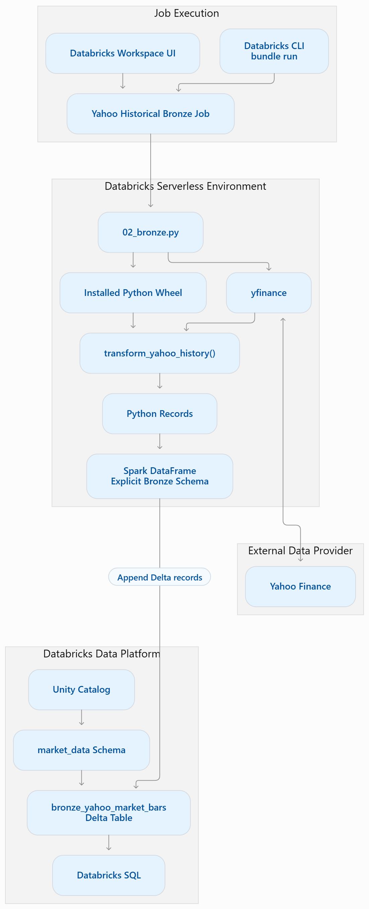

# Market Data Platform — Architecture

## 1. Architecture Overview

The Market Data Platform is a multi-provider data platform built on Databricks. It ingests market data from external providers, preserves provider observations, normalizes and reconciles data into canonical structures, and produces trusted datasets for analytical consumption.

The architecture follows a medallion pattern:

- **Bronze:** Provider observations and ingestion lineage.
- **Silver:** Normalized, validated, and reconciled market data.
- **Gold:** Analytical datasets and aggregations.

The layers separate provider-specific ingestion concerns from canonical domain semantics and downstream analytical requirements.

## 2. Data Flow

The initial implementation focuses on historical market data from Yahoo Finance. Subsequent stages introduce Finnhub trade data and additional ingestion patterns.

The intended data flow is:

1. **Ingestion:** Retrieve historical or live market data from providers.
2. **Bronze:** Persist provider observations in Delta tables, retaining source semantics and ingestion lineage. Observations should be preserved whenever they can be represented and persisted, regardless of whether their market-data values pass quality checks.
3. **Dead-letter handling:** Capture records that cannot be represented or persisted through the normal Bronze path, retaining the available source representation and failure context wherever possible.
4. **Data quality evaluation:** Evaluate preserved observations and processing results. Record quality findings separately from Bronze so that issues can be investigated without discarding the underlying observations.
5. **Silver:** Normalize provider observations into canonical market data, validate them against canonical requirements, and reconcile overlapping sources. Only suitable observations are promoted; observations that fail validation remain available in Bronze with their associated findings.
6. **Gold:** Produce analytical datasets and aggregations from trusted Silver data.
7. **Consumption:** Query analytical datasets through Databricks SQL and other analytical workloads.

Data quality evaluation is a cross-cutting responsibility rather than a separate medallion layer. Findings may be raised during ingestion, Bronze processing, or Silver transformations. Dead-letter handling is reserved for records that cannot be persisted through the normal Bronze path; it is distinct from quality findings for observations successfully preserved in Bronze.

Historical ingestion and controlled datasets are the initial focus. Incremental ingestion and live streaming are introduced in later implementation stages.

## 3. Data Layer Responsibilities

### Bronze — Provider Observations

Bronze stores provider-specific observations and events as received through the ingestion process. It preserves source data and relevant ingestion metadata so that observations can be validated, reprocessed, and audited.

Examples include:

- Historical OHLCV bars received from Yahoo Finance.
- Individual trade events received from Finnhub.
- Future market data from additional providers.

Bronze ingestion should preserve source semantics rather than prematurely converting all provider data into canonical domain models.

Bronze is a preservation layer, not a data-quality gate. An observation should not be rejected from Bronze merely because its market-data values fail business or quality validation. Where an observation can be represented and persisted, it should be retained for investigation and potential reprocessing.

For historical Yahoo Finance data, the initial Bronze implementation uses the observations returned by the `yfinance` client. These are provider-derived records, not necessarily the original HTTP response or wire payload.

#### Timestamp preservation

Provider timestamps must retain enough information to identify the original market-data instant and understand how the provider represented it.

For Yahoo historical bars, the source timestamp includes timezone information. Bronze will preserve:

- The provider's local timestamp as a timezone-naive timestamp.
- The provider timezone as a separate value, such as `America/New_York`.
- A normalized UTC timestamp, stored as a timezone-naive timestamp whose value represents UTC.

The UTC column uses an `\_utc` suffix. Its values must be explicitly converted from the source instant to UTC before the timezone information is removed for storage.

This approach preserves the provider's local time context while providing a consistent UTC timestamp for keys, joins, and downstream processing.

Delta timestamp columns do not retain the original timezone identity. The separate timezone field is therefore necessary to interpret the preserved local timestamp.

#### Observation identity and versioning

Bronze ingestion must be idempotent for identical provider observations without discarding changes made by a provider.

For Yahoo market bars, the initial business key is:

`(provider, symbol, interval, provider_timestamp_utc)`

A content hash, calculated from the relevant provider data fields, identifies the contents of an observation for that business key.

The resulting behavior is:

- **New business key:** Insert the observation.
- **Existing business key and identical content hash:** Deduplicate the observation.
- **Existing business key and different content hash:** Retain the changed observation as a separate version.

This means a provider correction or late-arriving revision does not overwrite the previously observed data. Both versions remain available for investigation and downstream processing.

The hash should be based on a consistent, deterministic representation of the provider fields that define the observation. Missing and non-finite values must be handled consistently rather than being silently converted to zero or causing otherwise retrievable observations to be discarded. The hash is a content fingerprint, not a replacement for the business key.

Bronze records also retain ingestion lineage, including the ingestion run that first captured the observation. Run-level metadata is recorded separately so ingestion attempts can be audited independently of whether they introduce new observations.

The current observation version is identified independently of its data-quality status. In particular, `is_current` indicates whether an observation is the latest version received for its business key; it does not indicate whether the observation is valid.

Delta transaction history provides a record of changes to the table itself. Observation versioning provides a separate record of changes to provider data. These serve different purposes.

### Silver — Normalization and Reconciliation

Silver transforms Bronze observations into canonical market data structures and brings data from different providers into a consistent representation.

Silver datasets include:

- `market_trades`: normalized individual trades from all trade providers.
- `provider_market_bars`: normalized one-minute bars from all bar providers, including bars derived by aggregating individual trades.
- `market_bars`: reconciled canonical one-minute bars, providing the trusted source for downstream market-bar analytics.

`provider_market_bars` retains provider identity and source lineage. It can contain multiple observations for the same symbol and bar timestamp when those observations originate from different providers.

`market_bars` represents the reconciled result. It provides a single canonical record for the applicable symbol and one-minute interval, according to the platform's reconciliation rules.

Provider identity and source lineage are retained so that observations can be compared, discrepancies investigated, and reconciliation rules refined.

Normalization, grain conversion, data quality validation, and cross-provider reconciliation are distinct responsibilities within the Silver processing layer.

Silver only promotes observations that meet the requirements of the applicable canonical data contract. Observations that fail those requirements remain available in Bronze, along with their associated data-quality findings, rather than being silently discarded.

### Data Quality and Dead-Letter Handling

Data quality evaluation identifies problems with provider observations and ingestion behavior without compromising Bronze's preservation responsibility.

Quality findings are recorded separately from Bronze observations. This allows the platform to retain the original observation while documenting why it may not be suitable for downstream processing.

Data quality findings should retain enough context to support investigation, including:

- Provider and affected symbol, where available.
- Observation identity and ingestion run.
- The validation rule that detected the problem.
- Issue severity and an explanatory message.
- The processing stage where the issue was detected.
- Detection time and, where applicable, resolution status.

This information should make it possible to identify recurring problems, monitor provider quality over time, and investigate whether an issue originates from provider behavior, a change in the provider's data, or a defect in the platform's ingestion or transformation logic.

A quality finding does not necessarily mean an observation must be discarded. For example, an observation with an invalid market value may remain in Bronze while being excluded from Silver.

Differences between providers discovered during reconciliation are not automatically data-quality failures. They may represent legitimate differences in provider coverage, timing, or reporting and should be evaluated according to the reconciliation rules.

#### Dead-letter handling

Some records cannot be persisted to the normal Bronze tables because they cannot be represented by the required schema or because ingestion fails before a usable observation can be constructed.

Examples include:

- Missing or unparseable timestamps when a valid observation key and UTC timestamp cannot be established.
- Malformed provider responses or records that cannot be converted into the Bronze representation.
- Records that fail persistence because of structural or schema incompatibilities.

These records should be captured through a separate dead-letter mechanism wherever possible. Dead-letter records should preserve the available source representation, ingestion context, and failure details so that the problem can be reviewed and potentially reprocessed.

Dead-letter handling is distinct from ordinary data-quality findings: a record can be preserved in Bronze and have quality findings, while a dead-letter record represents an observation that could not be persisted through the normal Bronze path.

### Gold — Analytics

Gold provides analytical datasets and aggregations built from trusted Silver data for consumption through Databricks SQL and other analytical workloads.

Gold focuses on analytical use cases rather than provider-specific ingestion or reconciliation logic.

## 4. Data Contracts

Data contracts define the expected structure and semantics of market data as it moves through the platform.

The platform distinguishes between provider observations and canonical domain models:

- **Bronze contracts** describe provider-specific observations and the metadata needed to preserve their meaning and lineage.
- **Silver contracts** describe normalized canonical market data, independent of the provider's original field names and representation.
- **Gold contracts** describe analytical datasets designed for downstream consumption.

Trades and bars are distinct data concepts and must retain their different semantics.

A canonical trade represents an individual transaction, including its price, quantity, symbol, provider, and trade timestamp.

A canonical bar represents an aggregation over a defined time interval, including its symbol, interval, timestamp, OHLC values, volume, and provider or reconciliation lineage as appropriate.

Timestamps use UTC as the common time reference. UTC timestamp fields use an `\_utc` suffix.

Python and Pydantic are used where appropriate to define and validate domain contracts. Spark and Delta schemas enforce the corresponding structures in the Databricks processing and storage layers.

## 5. Provider Integration

Provider-specific integration is separated from canonical data processing.

Each provider integration is responsible for retrieving or receiving data and preserving the provider's original semantics and relevant metadata.

Initial and planned integrations include:

- **Yahoo Finance:** Historical OHLCV market bars.
- **Finnhub:** Individual market trade events, initially through live streaming.

Provider-specific field names, timestamp representations, and data semantics are handled at the ingestion and normalization boundaries.

The platform should not assume that similarly named fields from different providers have identical meanings. For example, trade quantity and bar volume are distinct concepts and must be interpreted according to the provider and data type.

Provider integrations should remain replaceable without requiring changes to downstream analytical contracts.

## 6. Databricks Implementation Architecture

The Market Data Platform is implemented as a Python application deployed and executed within Databricks.

The architecture separates application logic from Databricks platform resources and the development and deployment tooling used to manage them.

### Development and Deployment

Local development uses VS Code, Python, uv, pytest, Ruff, and pre-commit. Application code, notebooks, SQL, and Databricks resource definitions are maintained in Git.

The Databricks CLI and Declarative Automation Bundles (Asset Bundles) validate and deploy the application and its associated resources to the Databricks workspace.

<!--  -->

### Runtime Execution

Databricks Jobs orchestrate the execution of notebooks in a serverless environment. The notebooks use the deployed Python application package for reusable ingestion and transformation logic.

The application produces structured records that are converted into Spark DataFrames and persisted as Delta tables governed by Unity Catalog.

<!--  -->

The initial implementation demonstrates this pattern through the Yahoo historical Bronze ingestion job. Future jobs and pipelines will extend the same architecture to Silver normalization, reconciliation, Gold analytics, and additional provider integrations.

### Separation of Responsibilities

The implementation maintains three distinct areas of responsibility:

- **Python application:** Provider integration, data contracts, transformations, validation, and reusable domain logic.
- **Databricks platform:** Serverless execution, Spark processing, Delta Lake storage, Unity Catalog governance, SQL access, and job orchestration.
- **Development and deployment tooling:** Local testing, code quality, packaging, version control, resource configuration, and deployment.

## 7. Design Principles

- **Independent implementation:** This project is an independent Databricks implementation of the market data platform. It shares domain requirements and architectural concepts with the original MDP, but does not depend on its code, packages, infrastructure, or runtime.
- **Databricks-native capabilities:** Prefer Databricks and Delta Lake capabilities where they provide meaningful advantages over application-managed infrastructure.
- **Separation of concerns:** Keep provider integration, Bronze persistence, Silver normalization and reconciliation, and Gold analytics as distinct responsibilities.
- **Preserve source information:** Retain provider observations and relevant metadata so data can be validated, reprocessed, compared, and audited.
- **Idempotent and version-aware ingestion:** Repeated identical observations should not create duplicates, while changed observations must remain available as separate versions.
- **Explicit data semantics:** Distinguish trades from bars, quantity from volume, provider timestamps from normalized UTC timestamps, and provider-level bars from reconciled canonical bars.
- **Reliable processing:** Design transformations to support repeatable execution, validation, and recovery from failures.
- **Incremental learning and implementation:** Build the platform in stages, validating individual Databricks capabilities and documenting architectural decisions as they are introduced.
- **Git as the source of truth:** Keep application code, SQL, configuration, and deployable resources version-controlled and reproducible.
