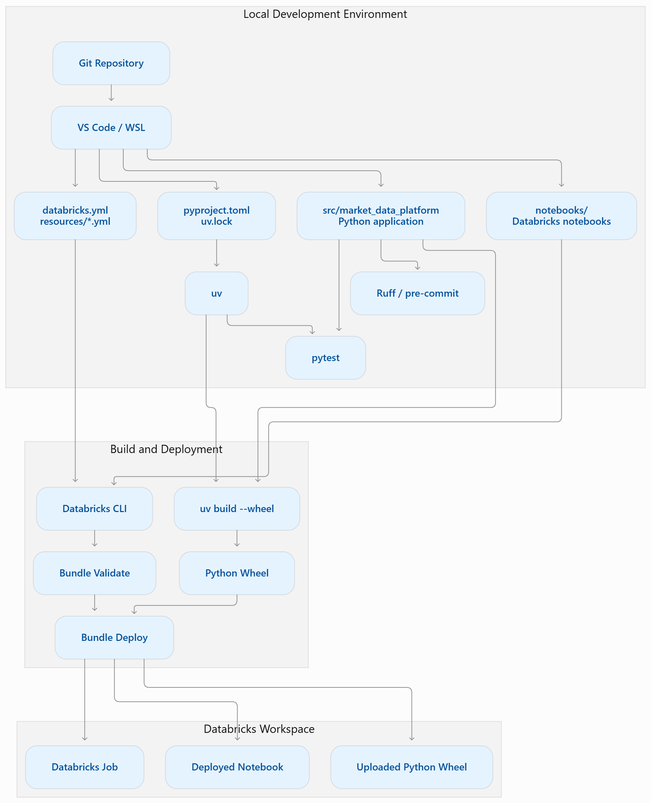

# Market Data Platform — Architecture

## 1. Architecture Overview

The Market Data Platform is a multi-provider data platform built on Databricks. It ingests market data from external providers, preserves provider observations, normalizes and reconciles data into canonical structures, and produces trusted datasets for analytical consumption.

The architecture follows a medallion pattern:

- **Bronze:** Provider observations and ingestion lineage.
- **Silver:** Normalized, validated, and reconciled market data.
- **Gold:** Analytical datasets and aggregations.

The layers separate provider-specific ingestion concerns from canonical domain semantics and downstream analytical requirements.

The implementation uses Databricks-native capabilities wherever they provide appropriate platform functionality, supplemented by Python for provider integrations and application-specific logic, and dbt for analytical modeling.

The principal technologies are:

- **Unity Catalog:** Data organization, governance, permissions, and lineage.
- **Delta Lake:** Transactional storage for lakehouse tables.
- **Auto Loader:** Incremental ingestion of supported files from cloud storage.
- **Lakeflow Spark Declarative Pipelines:** Managed data pipelines and pipeline-defined tables and transformations.
- **Python:** Provider integrations, domain contracts, and application-specific processing.
- **dbt:** Analytical SQL models, dependencies, tests, and documentation.
- **Lakeflow Jobs:** Workflow orchestration.
- **Databricks SQL:** Analytical querying and consumption.
- **Declarative Automation Bundles:** Version-controlled deployment of supported Databricks resources.

## 2. Data Flow

The initial implementation focuses on historical market data from Yahoo Finance. Subsequent stages introduce Finnhub trade data and additional ingestion patterns.

The implemented Yahoo Finance ingestion flow is:

1. **Provider integration:** Python uses the `yfinance` client to retrieve historical market data for a requested date range. Provider-specific API interactions and source semantics remain the responsibility of the Python integration.
2. **Raw source landing:** The extracted observations are normalized into the platform's landing representation and written as Parquet files in a Unity Catalog Volume. Each extraction receives a unique ingestion run ID and writes to a separate directory. Raw files are retained independently of Bronze processing to support replay, investigation, and reprocessing.
3. **Incremental file ingestion:** Auto Loader within a Lakeflow Spark Declarative Pipeline discovers and processes newly landed files. Its checkpoint/state tracks file-processing progress. Re-running the pipeline does not reprocess previously processed files, while files from a new extraction run can be discovered independently.
4. **Bronze:** Lakeflow manages the Bronze Delta table and appends the provider-derived observations from newly discovered files. The current implementation preserves overlapping observations across extraction runs, including identical observations and observations whose values have changed. It does not yet perform business-level deduplication, content hashing, or current-version selection.
5. **Schema handling:** Auto Loader provides schema inference and schema evolution capabilities. Separate proof-of-concept pipelines have demonstrated additive schema evolution and rescue mode. The production Yahoo Bronze pipeline currently uses Auto Loader's default schema-evolution behavior and includes a rescued-data column.
6. **Validation:** SQL validation checks evaluate completeness, business-key duplication, OHLC plausibility, provider metadata, ingestion lineage, and reconciliation between landed Parquet files and Bronze records. These checks currently provide validation evidence; a persistent data-quality findings framework has not yet been implemented.
7. **Silver:** The planned Silver layer will normalize provider observations into canonical market data, validate them against canonical requirements, and reconcile overlapping sources. It will also define how repeated observations and provider revisions are interpreted for downstream use.
8. **Gold:** The planned Gold layer will produce analytical datasets and aggregations from trusted Silver data. dbt is the intended tool for analytical SQL models, dependencies, tests, and documentation.
9. **Consumption:** Analytical datasets will be queried through Databricks SQL and other analytical workloads.

The ingestion design distinguishes file-level processing from business-level observation identity. Auto Loader incrementally discovers and tracks files it has processed. It does not deduplicate business observations across separate files. A new extraction run can contain observations whose business keys already exist in Bronze, and those observations are appended as new records.

This behavior is intentional in the current implementation: Bronze preserves successive provider observations and their ingestion-run lineage rather than selecting a definitive current observation. Identical observations and changed observations are both retained. Business-level deduplication, version selection, and reconciliation remain downstream design responsibilities.

Raw source files are retained independently of Bronze tables. A separate recreation experiment demonstrated that a newly deployed Lakeflow pipeline, with independent state and a new target table, could ingest all 10 records from the two existing Yahoo extraction runs without calling the provider again. This verifies that Bronze can be rebuilt from the retained raw landing data.

Data quality evaluation is a cross-cutting responsibility rather than a separate medallion layer. The current implementation uses SQL validation queries to inspect Bronze data. A persistent findings mechanism and dead-letter handling are future capabilities. They should distinguish observations successfully preserved in Bronze from records that cannot be represented or persisted through the normal ingestion path.

Lakeflow Spark Declarative Pipelines manage the transformations and tables assigned to them. dbt is intended to manage its own analytical models and resulting objects. These responsibilities should remain distinct to avoid multiple tools independently managing the same table.

Lakeflow Jobs are intended to coordinate provider-ingestion, pipeline, and analytical-model tasks. The current extraction and Bronze pipeline have been executed separately during implementation; sequential orchestration is a subsequent workflow improvement. Declarative Automation Bundles deploy supported resource definitions; deploying a resource does not itself execute the workload or populate its tables.

Historical ingestion and controlled datasets are the initial focus. The Yahoo implementation has validated the Python-to-Volume-to-Auto-Loader-to-Bronze flow, including incremental processing, schema experiments, validation, overlapping extraction runs, and recreation from retained raw files. Additional providers and live streaming are introduced in later implementation stages.

## 3. Data Layer Responsibilities

### Bronze — Provider Observations

Bronze stores provider-specific observations and events as received through the ingestion process. It preserves provider data and relevant ingestion metadata so that observations can be validated, reprocessed, compared, and audited.

Examples include:

- Historical OHLCV bars received from Yahoo Finance.
- Individual trade events received from Finnhub.
- Future market data from additional providers.

Bronze ingestion should preserve source semantics rather than prematurely converting all provider data into canonical domain models.

Bronze is a preservation layer, not a data-quality gate. An observation should not be rejected from Bronze merely because its market-data values fail business or quality validation. Where an observation can be represented and persisted, it should be retained for investigation and potential reprocessing. Records that cannot be represented or persisted through the normal Bronze path should be captured through the dead-letter mechanism wherever possible.

#### Raw source landing and ingestion

For the initial Yahoo Finance implementation, Python uses the `yfinance` client to retrieve historical market data for a requested date range. The resulting observations are written as Parquet files to a Unity Catalog Volume, which serves as the raw source landing area.

Raw source files are retained independently of Bronze tables. Each extraction produces uniquely identified files so that subsequent extraction runs do not overwrite previously landed data. Retaining these files provides a replayable source for investigating ingestion issues and reprocessing data when schemas, transformation logic, or interpretation of provider data changes.

Lakeflow Spark Declarative Pipelines use Auto Loader to incrementally discover and ingest newly landed files into Bronze Delta tables. Auto Loader tracks file-processing progress through its checkpoint mechanism, allowing the pipeline to resume processing without blindly ingesting previously processed files again.

File-level processing guarantees do not provide business-level deduplication. Separate extraction runs may produce different files containing overlapping historical observations. Bronze processing must therefore apply the platform's observation identity and content-hash rules to distinguish identical observations from provider revisions.

For historical Yahoo Finance data, the initial Bronze implementation uses the observations returned by the `yfinance` client. These are provider-derived records, not necessarily the original Yahoo Finance HTTP response or wire payload. The raw landing files preserve the extracted representation produced by the Python integration, rather than claiming to preserve the provider's original transport-level response.

#### Bronze preservation and data quality

Bronze preserves provider observations and their relevant ingestion metadata, including source file and ingestion-run lineage. Data-quality findings are recorded separately from the observations so that invalid or questionable market-data values remain available for investigation without being silently discarded.

Bronze ingestion must be idempotent for identical provider observations without discarding changes made by a provider. The business-level identity and versioning rules are defined below.

#### Timestamp preservation

Provider timestamps must retain enough information to identify the source's time representation and understand the semantics of the observation.

For Yahoo historical bars, the implementation preserves:

- `provider_timestamp_local`: The provider's timestamp represented as an ISO 8601 string, including its UTC offset.
- `provider_timezone`: The provider's IANA timezone, such as `America/New_York`.
- `provider_timestamp_utc`: The corresponding UTC instant, stored as a Spark/Delta timestamp.
- `bar_date`: The date derived from the provider's local timestamp.

The UTC timestamp is explicitly converted from the timezone-aware provider timestamp before being stored. Spark/Delta timestamp values do not retain the original timezone identity, so the separate provider timezone and local timestamp representation are retained.

An important distinction applies to daily Yahoo bars: their provider timestamp is a midnight local-time date label. It should not be interpreted as the actual market close time or as the instant at which the bar became final. The `bar_date` field represents the provider's local business date.

#### Observation identity and ingestion history

The current Yahoo historical Bronze implementation preserves observations from each extraction run.

The business key used to identify a daily market bar for validation is:

`(symbol, provider_interval, bar_date)`

This key identifies the market-data observation conceptually, but it is not currently enforced as a uniqueness constraint in Bronze.

Each extracted record also carries:

- `ingestion_run_id`: Identifies the extraction run that produced the record.
- `ingested_at_utc`: Records when the extraction process captured the record.
- `run_id`: The run identifier represented in the landing directory and discovered by Auto Loader.
- `raw_record`: The provider-derived row representation retained as JSON.

The current Bronze behavior is append-oriented:

- A new business key is appended.
- An identical observation arriving in a new extraction run is also appended.
- A changed observation for an existing business key is appended as another observation.
- Re-running the pipeline against already processed files does not append those files again.

The distinction is important: Auto Loader provides incremental file processing, not business-level deduplication or provider-revision management.

The current implementation does not calculate a content hash, maintain an `is_current` flag, or select a definitive current version. Those responsibilities will be considered when designing downstream normalization and reconciliation.

Delta transaction history records changes to the table itself. Ingestion-run metadata identifies the extraction associated with an observation. These provide different forms of history and lineage.

#### Bronze implementation ownership

Bronze table definitions and transformations should be managed by the selected Databricks pipeline implementation where those tables are pipeline-managed.

Auto Loader may provide the file-ingestion mechanism for source data that has been landed in supported cloud storage. It does not replace the provider integration that retrieves data from an external API.

The exact boundary between provider ingestion, source landing, and pipeline ingestion will be validated through the Lakeflow and Auto Loader proof of concept.

### Silver — Normalization and Reconciliation

Silver transforms Bronze observations into canonical market data structures and brings data from different providers into a consistent representation.

Silver datasets include:

- `market_trades`: normalized individual trades from all trade providers.
- `provider_market_bars`: normalized one-minute bars from all bar providers, including bars derived by aggregating individual trades.
- `market_bars`: reconciled canonical one-minute bars, providing the trusted source for downstream market-bar analytics.

`provider_market_bars` retains provider identity and source lineage. It can contain multiple observations for the same symbol and bar timestamp when those observations originate from different providers.

`market_bars` represents the reconciled result. It provides a single canonical record for the applicable symbol and one-minute interval, according to the platform's reconciliation rules.

Provider identity and source lineage are retained so that observations can be compared, discrepancies investigated, and reconciliation rules refined.

Normalization, grain conversion, data quality validation, and cross-provider reconciliation are distinct responsibilities within the Silver processing layer.

Silver only promotes observations that meet the requirements of the applicable canonical data contract. Observations that fail those requirements remain available in Bronze, along with their associated data-quality findings, rather than being silently discarded.

Lakeflow Spark Declarative Pipelines are the intended mechanism for managing appropriate Silver transformations and their pipeline-managed tables. Python remains available for reusable domain logic and specialized processing, rather than serving as a replacement for the platform's managed pipeline capabilities.

### Data Quality and Dead-Letter Handling

Data quality evaluation identifies problems with provider observations and ingestion behavior without compromising Bronze's preservation responsibility.

Quality findings are recorded separately from Bronze observations. This allows the platform to retain the original observation while documenting why it may not be suitable for downstream processing.

Data quality findings should retain enough context to support investigation, including:

- Provider and affected symbol, where available.
- Observation identity and ingestion run.
- The validation rule that detected the problem.
- Issue severity and an explanatory message.
- The processing stage where the issue was detected.
- Detection time and, where applicable, resolution status.

This information should make it possible to identify recurring problems, monitor provider quality over time, and investigate whether an issue originates from provider behavior, a change in the provider's data, or a defect in the platform's ingestion or transformation logic.

A quality finding does not necessarily mean an observation must be discarded. For example, an observation with an invalid market value may remain in Bronze while being excluded from Silver.

Differences between providers discovered during reconciliation are not automatically data-quality failures. They may represent legitimate differences in provider coverage, timing, or reporting and should be evaluated according to the reconciliation rules.

#### Dead-letter handling

Some records cannot be persisted to the normal Bronze tables because they cannot be represented by the required schema or because ingestion fails before a usable observation can be constructed.

Examples include:

- Missing or unparseable timestamps when a valid observation key and UTC timestamp cannot be established.
- Malformed provider responses or records that cannot be converted into the Bronze representation.
- Records that fail persistence because of structural or schema incompatibilities.

These records should be captured through a separate dead-letter mechanism wherever possible. Dead-letter records should preserve the available source representation, ingestion context, and failure details so that the problem can be reviewed and potentially reprocessed.

Dead-letter handling is distinct from ordinary data-quality findings: a record can be preserved in Bronze and have quality findings, while a dead-letter record represents an observation that could not be persisted through the normal Bronze path.

### Gold — Analytics

Gold provides analytical datasets and aggregations built from trusted Silver data for consumption through Databricks SQL and other analytical workloads.

Gold focuses on analytical use cases rather than provider-specific ingestion or reconciliation logic.

dbt is the intended modeling tool for this layer. It provides SQL-based model definitions, dependency management, tests, and documentation. dbt-managed analytical objects should have a clear ownership boundary from tables managed by Lakeflow pipelines.

Databricks SQL provides the primary interactive analytical consumption interface.

## 4. Data Contracts

Data contracts define the expected structure and semantics of market data as it moves through the platform.

The platform distinguishes between provider observations and canonical domain models:

- **Bronze contracts** describe provider-specific observations and the metadata needed to preserve their meaning and lineage.
- **Silver contracts** describe normalized canonical market data, independent of the provider's original field names and representation.
- **Gold contracts** describe analytical datasets designed for downstream consumption.

Trades and bars are distinct data concepts and must retain their different semantics.

A canonical trade represents an individual transaction, including its price, quantity, symbol, provider, and trade timestamp.

A canonical bar represents an aggregation over a defined time interval, including its symbol, interval, timestamp, OHLC values, volume, and provider or reconciliation lineage as appropriate.

Timestamps use UTC as the common time reference. UTC timestamp fields use an `_utc` suffix.

Python and Pydantic are used where appropriate to define and validate domain contracts. Spark and Delta schemas enforce the corresponding structures in the Databricks processing and storage layers. dbt tests provide additional validation for analytical models and their expected relationships and properties.

## 5. Provider Integration

Provider-specific integration is separated from canonical data processing.

Each provider integration is responsible for retrieving or receiving data and preserving the provider's original semantics and relevant metadata.

Initial and planned integrations include:

- **Yahoo Finance:** Historical OHLCV market bars.
- **Finnhub:** Individual market trade events, initially through live streaming.

Provider-specific field names, timestamp representations, and data semantics are handled at the ingestion and normalization boundaries.

The platform should not assume that similarly named fields from different providers have identical meanings. For example, trade quantity and bar volume are distinct concepts and must be interpreted according to the provider and data type.

Provider integrations should remain replaceable without requiring changes to downstream analytical contracts.

Python is the primary implementation language for provider-specific API integrations. Where an integration produces files in a supported cloud-storage location, Auto Loader can provide incremental file ingestion into the lakehouse. Other ingestion paths may be appropriate depending on the source and the capabilities available in the target Databricks environment.

## 6. Databricks Implementation Architecture

The Market Data Platform is implemented using Databricks platform capabilities alongside a Python application and a dbt analytical project.

The architecture separates application logic, raw source landing, managed data processing, analytical modeling, workflow orchestration, and deployment tooling. Each component has a defined responsibility and should not independently manage the same data objects.

### Development and Deployment

Local development uses VS Code, Python, uv, pytest, Ruff, and pre-commit. Application code, notebooks, SQL, dbt models, and Databricks resource definitions are maintained in Git.

The Databricks CLI and Declarative Automation Bundles validate and deploy supported Databricks resources to the workspace.

GitHub Actions provides CI validation and can be extended to support deployment workflows.

Bundles define and deploy resources; they do not independently execute workloads or populate data tables. The deployment and runtime model distinguishes between:

- **Resource deployment:** Creating or updating supported Databricks workspace resources and configurations.
- **Pipeline execution:** Running Lakeflow pipelines to materialize or update pipeline-managed tables.
- **Analytical model execution:** Running dbt models to create or update dbt-managed analytical objects.
- **Data ingestion:** Retrieving source data through provider integrations and landing it for processing through the appropriate ingestion workflows.

<!--  -->

### Runtime and Data Processing

The runtime architecture separates provider-specific ingestion and raw source landing from managed lakehouse processing.

**Provider ingestion**

Python integrations retrieve data from external providers and preserve provider-specific semantics. For the initial Yahoo Finance implementation, Python uses the `yfinance` client to retrieve historical market data for a requested date range.

Provider integrations are responsible for external API interactions and preparing the extracted observations for ingestion. They do not independently manage the downstream Bronze or Silver tables.

**Raw source landing**

The initial Yahoo Finance integration writes extracted observations as Parquet files to a Unity Catalog Volume. The Volume provides the raw source landing area, separate from the managed Delta tables used by the medallion architecture.

Each extraction produces uniquely identified files so that subsequent runs do not overwrite previously landed source data. Raw files are retained independently of Bronze processing to support replay, investigation, and reprocessing.

These files preserve the extracted representation produced by the Python integration; they should not be treated as the original provider HTTP response or wire payload.

**File ingestion**

Lakeflow Spark Declarative Pipelines use Auto Loader to incrementally discover and process newly landed files from the Unity Catalog Volume.

Auto Loader tracks file-processing progress through its checkpoint mechanism and provides incremental file ingestion and supported schema-evolution capabilities. It does not call external provider APIs or provide business-level deduplication of observations across separate files.

Because historical extraction runs may contain overlapping observations, Bronze processing applies the platform's observation identity and content-hash rules. Identical observations should not create additional versions, while changed provider observations should be retained as new versions.

**Schema inference and evolution**

The Yahoo Bronze pipeline currently uses Auto Loader to infer the Parquet source schema and uses its default schema-evolution behavior. Lakeflow manages the pipeline's state and schema information in this implementation.

Separate schema-evolution proof-of-concept pipelines have demonstrated two behaviors:

- With the default additive schema-evolution behavior, a newly encountered field can be added to the inferred schema and the pipeline can process subsequent files using the evolved schema.
- With `cloudFiles.schemaEvolutionMode = rescue`, unexpected fields are retained in the rescued-data column rather than being promoted into the table schema.

The actual Yahoo Bronze table includes `_rescued_data`, and the schema-evolution experiments verified that unexpected fields can be preserved for investigation.

The intended governance approach is to keep the landing contract explicit and review changes to provider data deliberately. Unexpected fields should be made observable and assessed before being incorporated into the analytical contract. Rescue mode is an available containment mechanism, not a complete dead-letter or data-quality framework.

**Bronze and Silver processing**

Lakeflow Spark Declarative Pipelines manage the transformations and tables assigned to them. These pipelines are responsible for the appropriate Bronze and Silver processing workflows, including dependencies, data-quality evaluation, and pipeline-managed table lifecycle.

Bronze preserves provider observations and relevant ingestion metadata, including source-file and ingestion-run lineage. Data-quality findings are recorded separately so that questionable observations remain available for investigation when they can be represented and persisted.

Silver normalizes provider observations into canonical market data, applies canonical validation, and reconciles data across providers. Only suitable observations are promoted into trusted canonical datasets.

Python code can support reusable domain logic and specialized operations within the processing architecture, while Lakeflow remains the owner of its pipeline-managed tables.

**Gold analytical modeling**

dbt defines and executes analytical SQL models using Databricks as the data platform. It manages its own model dependencies, tests, documentation, and materialized analytical objects.

Gold models consume trusted Silver data to provide analytical datasets and aggregations for downstream use.

**Orchestration**

Lakeflow Jobs coordinate the execution of provider-ingestion tasks, Lakeflow pipelines, dbt tasks, and other workflow components. Each task retains responsibility for its own processing function.

**Storage and governance**

Delta Lake provides transactional storage for Bronze, Silver, and Gold tables. Unity Catalog organizes and governs data assets, including schemas, tables, and Volumes, and provides relevant access-control and lineage capabilities.

Unity Catalog Volumes provide file storage for raw source landing; they are distinct from the Delta tables managed through the lakehouse processing architecture.

**Consumption**

Databricks SQL provides access to analytical datasets, particularly the Gold layer, for interactive queries and downstream analytical workloads.

<!--  -->

### Separation of Responsibilities

| Component | Primary responsibility |
|---|---|
| Git | Source control for application code, configuration, pipeline definitions, and analytical models |
| Declarative Automation Bundles | Deployment of supported Databricks resources |
| Unity Catalog | Data organization, governance, permissions, and lineage |
| Delta Lake | Transactional data storage |
| Python application | Provider integrations, domain contracts, and specialized application logic |
| Auto Loader | Incremental ingestion of supported files from cloud storage |
| Lakeflow Spark Declarative Pipelines | Managed data transformations and pipeline-owned tables |
| dbt | Analytical SQL models, dependencies, tests, and documentation |
| Lakeflow Jobs | Workflow orchestration and task coordination |
| Databricks SQL | Analytical querying and consumption |
| GitHub Actions | CI validation and deployment automation |

### Data Object Ownership

A data object should have one clearly defined owner responsible for creating and updating it.

- **Bundle-managed resources:** Resource definitions are maintained in Git and deployed through Declarative Automation Bundles.
- **Unity Catalog objects:** Catalogs, schemas, permissions, and other supported configurations are managed through the appropriate Databricks resource and governance mechanisms.
- **Lakeflow-managed tables:** Tables defined and managed by Lakeflow pipelines are created and updated through pipeline execution.
- **dbt-managed models:** Analytical objects defined by dbt are created and updated through dbt execution.
- **Source data:** Provider integrations and ingestion workflows are responsible for retrieving and delivering source data.

The same table should not be independently managed by both Lakeflow and dbt. dbt can consume Lakeflow-managed tables as upstream inputs, while maintaining ownership of its own analytical models.

The exact deployment and execution mechanisms will be validated against Databricks Free Edition capabilities during implementation.

## 7. Design Principles

- **Independent implementation:** This project is an independent Databricks implementation of the market data platform. It shares domain requirements and architectural concepts with the original MDP, but does not depend on its code, packages, infrastructure, or runtime.
- **Databricks-native capabilities:** Prefer Databricks and Delta Lake capabilities where they provide meaningful advantages over application-managed infrastructure.
- **Complementary industry-standard tools:** Use tools such as dbt where they provide a distinct capability that complements the Databricks platform.
- **Separation of concerns:** Keep provider integration, Bronze persistence, Silver normalization and reconciliation, and Gold analytics as distinct responsibilities.
- **Clear data ownership:** Each managed table or analytical object should have one defined owner and lifecycle.
- **Preserve source information:** Retain provider observations and relevant metadata so data can be validated, reprocessed, compared, and audited.
- **Idempotent and version-aware ingestion:** Repeated identical observations should not create duplicates, while changed observations must remain available as separate versions.
- **Explicit data semantics:** Distinguish trades from bars, quantity from volume, provider timestamps from normalized UTC timestamps, and provider-level bars from reconciled canonical bars.
- **Reliable processing:** Design transformations to support repeatable execution, validation, and recovery from failures.
- **Reproducible deployment and execution:** Keep resource definitions, application code, pipeline definitions, and analytical models version-controlled. Distinguish deploying definitions from executing workloads and restoring data.
- **Incremental learning and implementation:** Build the platform in stages, validating individual Databricks capabilities and documenting architectural decisions as they are introduced.
- **Git as the source of truth:** Keep application code, SQL, configuration, and deployable resources version-controlled and reproducible.
